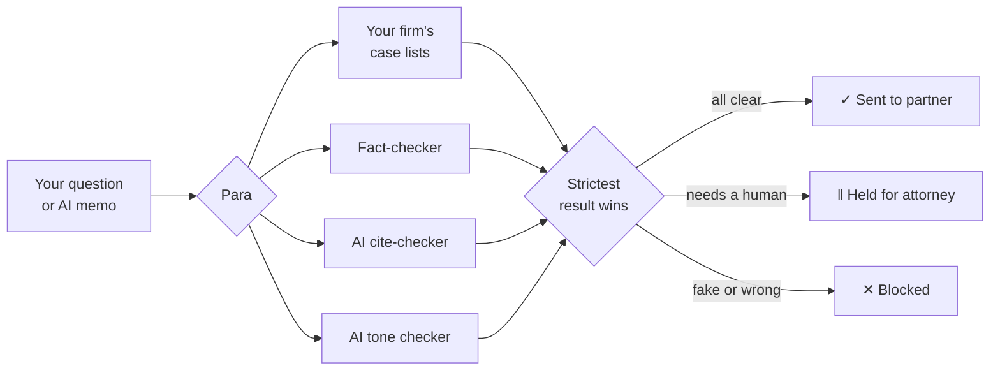

# ¶ Para

**Stop fake cases before your partner reads them.**

Para checks AI-written legal research memos before they're sent, and stops the ones that cite cases
that don't exist, misquote a holding, or argue instead of inform. It's free, it's one file, and it
runs on your own computer.

**[Visit the website](https://ridhwanlai.github.io/Approval-Gate/)** ·
**[Download Para (free)](https://github.com/Ridhwanlai/Approval-Gate/raw/main/docs/download/para.pyz)** ·
**[See how it decides](POLICY.md)** ·
**[Book a call](https://calendly.com/ridhwanlai-badmos/30min)**

---

## The problem

In *Mata v. Avianca* (2023), two New York lawyers filed a brief built on cases that ChatGPT made
up. The cases sounded real. The lawyers were sanctioned.

A trust score can't catch this. A fake case isn't a public fact anyone can look up, so an AI
fact-checker happily rates the memo as fine. The only thing that knows the case is fake is
**your firm's own list of cases it has checked**.

## What Para does

Here is a real memo Para checked. The AI fact-checker scored it a perfect 100:

> "In *Varghese v. China Southern Airlines*, the court held that the Montreal Convention tolls the
> statute of limitations during bankruptcy."
>
> **Fact-checker:** GREEN, 100 out of 100
>
> **Para:** ✕ **Blocked.** *Varghese v. China Southern Airlines* is on the firm's list of fabricated
> cases. It was cited in the *Mata v. Avianca* brief, and the court found it did not exist. The
> partner never received this memo.

Every memo ends one of three ways:

| | What happens |
|---|---|
| ✓ **Approved** | Every check passed. The memo goes to the partner. |
| ‖ **Held** | Something needs a human: a case Para can't verify, overconfident language, or a check that couldn't finish. An attorney reviews it first. |
| ✕ **Blocked** | A fake or misquoted case, or a false statement. It can't be sent until it's fixed. |

## Why Para is different

- **It checks against your firm's own list.** Not the internet's opinion: the cases your firm has
  actually verified, and the ones it knows are fake.
- **Four AI agents, each with one job.** One writes a first draft from your question, one checks
  every citation, one flags advocacy ("slam dunk!") in what should be neutral analysis, and one
  drafts a fix when a memo is held or blocked. They run on [HarnessRouter](https://harnessrouter.ai),
  and you choose the AI model each one uses.
- **The AI can't overrule the rules.** Para's own code makes every decision. An AI agent can make
  a memo stricter, never looser, so a memo can't talk its way through.
- **It fails safe.** If anything is down or unsure, the memo is held for a person. It is never sent
  unread.
- **It shows its work.** Every decision comes with the reason, the evidence and a log you can audit.
- **It's free and private.** One small file on your own computer. Nothing to install, no account
  with us, no subscription.

## Proof

We ran the challenge's 16 practice memos through Para with the live AI agents:

| | |
|---|---|
| Correct decisions | **16 of 16** |
| Bad memos caught | **8 of 8** |
| Good memos wrongly stopped | **0 of 8** |

At the Decision-Grade AI Buildathon, the first version scored **48.3 of 50 measured points** on the
sealed test set and passed all six failure drills.

## Get it free in three steps

1. **[Download `para.pyz`](https://github.com/Ridhwanlai/Approval-Gate/raw/main/docs/download/para.pyz)**
   (a single 100 KB file). You need Python 3.9 or newer; Macs and Linux usually have it.
2. **Get a free HarnessRouter account** at [harnessrouter.ai](https://harnessrouter.ai) and create
   an API key. This runs the AI agents.
3. **Open Terminal** in the folder where you saved the file and type:

   ```
   python3 para.pyz
   ```

   (On Windows: `py para.pyz`.) Paste your key when asked; it's hidden as you type and stays on your
   computer. Para sets up its agents and opens in your browser.

Then type a research question and choose **Draft with AI**, or paste a memo and choose
**Check and send to partner**.

## How it works



## Questions

**Does Para replace a lawyer?** No. It's a checking tool, not legal advice. An attorney stays
responsible for every memo.

**Where does my memo go?** Para runs on your computer. To run the AI checks, the memo text goes to
HarnessRouter under your own account, and nowhere else.

**What does it cost?** Para is free. HarnessRouter's free plan was enough for our testing; heavy
daily use may need one of their paid plans. If you'd like hands-on help, setup and support plans
start at $20 a month: [book a call](https://calendly.com/ridhwanlai-badmos/30min), and you can pay
by Interac e-Transfer or card after it.

**Can I use my firm's own case lists?** Yes. They're two simple files: the cases you've verified,
and the ones you know are fake.

## More

- [How Para decides, rule by rule](POLICY.md)
- [For developers: how it's built, tested and run](DEVELOPERS.md)
- [The original buildathon challenge](CHALLENGE.md) and [submission](TEAM_README.md)

*Para is a checking tool for legal research memos. It is not legal advice and does not replace an
attorney's review. Fact-checking (Ezio) is simulated in this release.*
